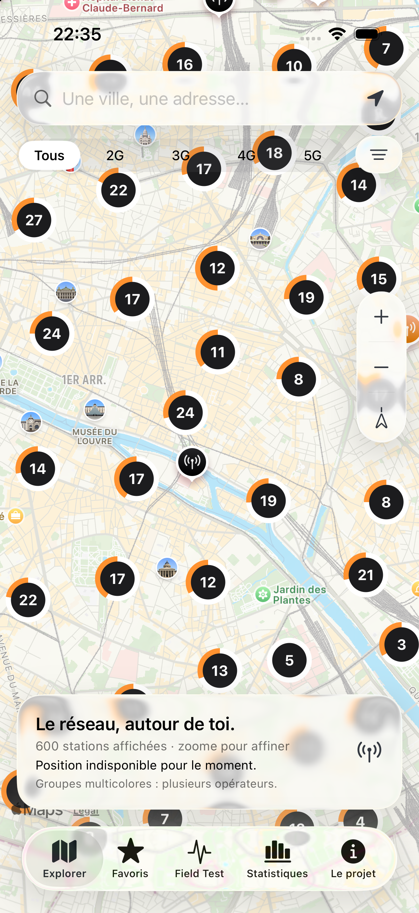

<p align="center">
  <picture>
    <source media="(prefers-color-scheme: dark)" srcset="App/Assets.xcassets/Brand.imageset/pylo-dark.png">
    
  </picture>
</p>

<h1 align="center">Pylo</h1>
<p align="center"><strong>Le réseau mobile, autour de toi.</strong><br>2G · 3G · 4G · 5G</p>

Je suis étudiant et j’ai créé Pylo pour comprendre les antennes autour de moi et ce qui se cache derrière les logos de réseau de mon iPhone. L’idée : tout retrouver dans une app simple, gratuite, sans pub et sans compte.

Pylo est écrite en Swift, avec une interface native, des données ANFR consultables hors ligne et un guide pour apprendre à lire Field Test sans se perdre dans les acronymes.

**Gratuite et open source · développée par un étudiant · licence GPL-3.0.**

## Un aperçu de l’app

<p align="center">
  <picture>
    <source media="(prefers-color-scheme: dark)" srcset="docs/pylo-iphone-dark.png">
    
  </picture>
</p>

*Capture de la version actuelle dans le simulateur iPhone. Les stations affichées proviennent de la base ANFR ; ce ne sont pas des données de démonstration.*

## Ce qu’on peut faire avec Pylo

### Explorer les antennes

- Naviguer sur une carte Apple Plans, chercher une ville ou une adresse avec des suggestions pendant la saisie, puis se placer autour de sa position.
- Filtrer les stations par **2G, 3G, 4G, 5G** et par opérateur, y compris les opérateurs d’outre-mer présents dans la source.
- Repérer les opérateurs grâce à leurs couleurs : **Orange en orange, Free en noir en thème clair et en blanc en thème sombre, SFR en rouge et Bouygues Telecom en turquoise**. Les regroupements mélangent les couleurs des opérateurs présents.
- Zoomer avec les gestes habituels ou les boutons **+ / −**.
- Garder des stations en favoris, les partager et ouvrir un itinéraire dans Plans.

La carte utilise les regroupements natifs de MapKit. Elle affiche au maximum **600 stations par zone** : il suffit de zoomer pour affiner.

### Comprendre chaque station

Les fiches séparent les informations au lieu de mélanger toutes les bandes dans une seule ligne :

| Information | Ce que Pylo affiche |
| --- | --- |
| Réseaux et bandes | GSM, UMTS, LTE, NR et leurs bandes en MHz, regroupés par génération |
| État | L’état déclaré de chaque système : projet approuvé, en service, techniquement opérationnel… |
| Dates | La date du système dans la source et la date de publication des données |
| Supports | Les identifiants des supports physiques, leur hauteur renseignée et leurs coordonnées |
| Orientation | Les azimuts ANFR et un schéma avec les directions déclarées |
| Depuis ta position | La distance à vol d’oiseau, le cap vers la station et le cap de l’iPhone lorsque disponible |

Une station peut être rattachée à plusieurs supports : Pylo les conserve et les distingue. Le repère de carte et la distance utilisent le premier support enregistré ; la fiche liste les supports disponibles.

La page carte n’affiche pas de titre ni de bandeau de navigation au-dessus de la recherche.

Les flèches d’orientation sont attachées à la tête des repères et gardent la même taille à l’écran. Un fin contour clair les distingue du fond, y compris pour les couleurs sombres. Elles s’effacent pendant le déplacement ou le zoom, puis reviennent après l’arrêt. Pour alléger le rendu, elles concernent seulement les stations individuelles visibles : **12 stations et 48 flèches maximum**, avec six directions au plus par station sur la carte. La fiche garde les directions complètes.

**Ces flèches montrent une orientation, pas une portée ni une zone de couverture.** La distance, les murs, le relief, les interférences et la charge du réseau jouent tous sur la réception. Pylo explique ces limites et ne transforme pas une distance en faux niveau de signal.

### Lire Field Test, simplement

Le guide remplace le carnet de relevés manuels. Il explique comment ouvrir le menu de l’iPhone avec le code `*3001#12345#*`, quoi regarder en premier et comment interpréter les champs courants :

- **Puissance** : RSRP, SS-RSRP, CSI-RSRP, RSSI, RSCP.
- **Qualité et bruit** : RSRQ, SINR, SNR, Ec/No et Ec/Io, avec des repères indicatifs.
- **Technologie** : RAT, GSM, GPRS, EDGE, UMTS/WCDMA, HSPA/HSPA+, LTE/LTE-Advanced, NR, NSA et SA.
- **Bandes et canaux** : Band, ARFCN, UARFCN, EARFCN et NR-ARFCN.
- **Identifiants** : PCI, Cell ID, ECI, NCI, eNodeB, gNodeB, RNC, MCC/MNC, TAC et LAC.
- **Pour aller plus loin** : agrégation de porteuses, PCC/SCC, largeur de canal, modulation, CQI, MCS et Timing Advance.

Un dictionnaire permet de rechercher un terme. Le décodeur **ECI LTE** accepte le décimal ou l’hexadécimal et sépare l’eNodeB de l’identifiant local de cellule. Le guide explique ensuite comment chercher une correspondance documentée avec un site.

**La station la plus proche n’est pas forcément celle utilisée par l’iPhone.** Un PCI seul ne permet pas de l’identifier et un identifiant réseau n’est pas un identifiant ANFR.

### Voir les informations accessibles sur iPhone

Pylo affiche le type de connexion internet, les technologies radio déclarées par iOS pour les lignes disponibles et l’état du mode données réduites sur la connexion active. Une information radio non transmise est expliquée séparément, sans être confondue avec une absence de réseau. Le bouton d’actualisation relit la connexion et les informations radio ; les changements radio et le retour dans l’app déclenchent aussi une lecture. La localisation et la boussole sont utilisées à la demande pour les distances et les directions.

iOS ne donne pas aux apps l’accès public à la cellule connectée, aux bandes actives ou aux mesures radio brutes RSRP/RSRQ/SINR. Les données disponibles dépendent de l’appareil et du réseau ; sur simulateur, les informations cellulaires sont généralement absentes. Les menus Field Test changent aussi selon le modem, iOS et l’opérateur.

### Explorer les statistiques

La page Statistiques analyse **toute la base**, indépendamment du zoom de la carte, avec un filtre par opérateur :

- Nombre de stations, de supports physiques distincts, de systèmes et d’opérateurs.
- Diagramme en anneau de la répartition des stations par opérateur.
- Histogrammes par génération et par bande de fréquence.
- Graphique des dates de systèmes déclarées sur les douze derniers mois de la source.
- Apparitions et retraits de stations entre deux publications compatibles, lorsque la comparaison est disponible.

La copie embarquée du **29 octobre 2026** contient **139 406 stations**, **72 940 supports distincts** et **820 366 couples station–système**.

Une même station peut compter plusieurs générations et plusieurs bandes : les graphiques ne s’additionnent pas tous au total des stations. Les dates des systèmes ne sont pas des dates d’ajout au catalogue. La première copie enrichie initialise l’historique ; Pylo ne fabrique pas de chiffre pour les « nouvelles antennes du mois » lorsqu’il manque une copie de comparaison.

## Les mises à jour ANFR — rien à importer

L’ANFR suit son propre calendrier : son catalogue indique une fréquence **hebdomadaire**, pas un jour fixe au début du mois. Pylo ne suppose donc aucune date de publication.

1. **Chaque jour à 07:23 UTC**, GitHub Actions vérifie la dernière ressource du catalogue officiel. Si elle est inchangée, il ne reconstruit rien.
2. Si la source a changé, le projet télécharge cette archive, prépare la base, la valide et la publie avec son empreinte SHA-256. Le manifeste public est mis à jour seulement une fois les fichiers disponibles.
3. Sur l’iPhone, Pylo vérifie la version **à l’ouverture ou au retour dans l’app, au maximum une fois par jour**, en Wi-Fi. Une base plus récente est téléchargée et installée automatiquement, hors mode données réduites.
4. L’ancienne copie reste disponible tant que le téléchargement, l’empreinte et les vérifications SQLite n’ont pas réussi. Les favoris ne sont pas supprimés.

Dans **Le projet**, on peut désactiver les mises à jour automatiques, voir la date des données et de la dernière vérification, ou toucher **Vérifier maintenant**. L’import de fichier reste disponible dans une rubrique de dépannage, mais n’est plus nécessaire pour l’usage normal.

La vérification automatique attend que l’app soit ouverte : iOS ne garantit pas qu’une app fermée sera réveillée tous les jours. En cas de Wi-Fi absent ou d’échec, la copie locale continue de fonctionner. Les mises à jour de données ne mettent pas à jour le code de l’application lui-même.

Pour lancer une publication toi-même : ouvre [Actions → Mise à jour ANFR](https://github.com/Logarex/Pylo/actions/workflows/anfr.yml), puis **Run workflow**. L’option **force** permet de reconstruire la base même si l’archive ANFR n’a pas changé. Le calendrier GitHub peut subir des retards ; ce lancement manuel reste disponible.

Tout reste dans **un seul dépôt public** : code, [manifeste](data/manifest.json) et [publications des données](https://github.com/Logarex/Pylo/releases). Aucun jeton GitHub n’est intégré dans l’app. Les téléchargements passent par GitHub sans transmettre les favoris, la position ou le cap.

Le manifeste référence une publication immuable de la base compressée, avec la version source, la date, la taille et le SHA-256. Le workflow compare aussi les identifiants avec la copie précédente pour les statistiques d’évolution. Les données ANFR restent sous Licence Ouverte 2.0.

La copie embarquée est compressée : environ **36 Mo** dans le projet et **146 Mo** une fois décompressée. Elle reste disponible hors ligne ; le fond de carte, les recherches et les itinéraires peuvent nécessiter internet.

## Installer et lancer le projet

Il faut **Xcode 26 ou plus récent** et **iOS 18 minimum**.

1. Clone le dépôt et ouvre `Pylo.xcodeproj`.
2. Sélectionne le schéma **Pylo**, puis un simulateur iPhone.
3. Pour ton iPhone, choisis ton équipe dans **Signing & Capabilities** et adapte l’identifiant d’application si nécessaire.

Aucun paquet tiers à installer. L’interface utilise des accents neutres, graphite en clair et gris clair en sombre, pour distinguer les commandes des couleurs des opérateurs. L’app suit les thèmes clair/sombre et utilise Liquid Glass sur iOS 26+, avec des matériaux système sur les versions antérieures.

Pour vérifier le cœur Swift et reconstruire les données sur Mac :

```sh
swift test
mkdir -p output
swift run -c release anfr-import output/antennas.sqlite
```

Un CSV officiel déjà extrait peut aussi être fourni :

```sh
swift run -c release anfr-import output/antennas.sqlite /chemin/observatoire.csv
```

## Une architecture simple à reprendre

| Dossier | Rôle |
| --- | --- |
| `App/` | Interface SwiftUI, carte native MapKit, fiches, Field Test et graphiques Swift Charts |
| `Sources/PyloCore/` | Modèles, CSV, SQLite, géométrie et limites de rendu des orientations |
| `Sources/ANFRImport/` | Outil de récupération et de préparation des données, écrit en Swift |
| `Tests/` | Parsing, filtres, statistiques, comparaisons, supports multiples et orientations |
| `.github/workflows/` | Vérifications et surveillance quotidienne du catalogue ANFR |

Les fichiers du cœur sont partagés entre l’app, les tests et l’importeur. SQLite, zlib et la décompression ZIP sur Mac reposent sur les outils du système. Pas de serveur Pylo à maintenir.

Les recherches de carte s’exécutent hors du fil principal après la fin du mouvement. Les repères sont réutilisés, les images de groupes sont mises en cache et les orientations utilisent une seule couche de dessin bornée. La fluidité et les comportements radio restent à vérifier sur les différents modèles d’iPhone avant une distribution TestFlight ou App Store.

## Vie privée, sources et liens

Les favoris restent sur l’appareil. Pylo ne conserve pas la position et le cap et ne les envoie pas à un serveur Pylo. Apple Plans traite les recherches et les itinéraires selon ses propres conditions.

- [Données officielles ANFR sur les réseaux mobiles](https://www.data.gouv.fr/datasets/donnees-sur-les-reseaux-mobiles) — Licence Ouverte 2.0.
- [Observatoire ANFR](https://www.anfr.fr/gestion-des-frequences-sites/lobservatoire).
- [API du catalogue utilisée par l’importeur](https://www.data.gouv.fr/api/1/datasets/6ab291cf426d615c84196260/).
- [Apple : limites d’accès aux mesures de signal](https://developer.apple.com/forums/thread/721067) et [technologie radio déclarée par CoreTelephony](https://developer.apple.com/documentation/coretelephony/cttelephonynetworkinfo/servicecurrentradioaccesstechnology).
- [Repères de lecture des mesures, Teltonika](https://wiki.teltonika-networks.com/view/Mobile_Signal_Strength_Recommendations) — indicatifs, sans garantie de débit.
- [RNC Mobile](https://www.rncmobile.net/) — un lien vers leur travail communautaire d’identification. Une proposition de contact est préparée ; **aucun partenariat n’est confirmé et leur base n’est pas intégrée**.

Pour reprendre le projet : [maintenance](docs/MAINTENANCE.md), [RNC Mobile et proposition de contact](docs/RNC-MOBILE.md), [logos clair/sombre](docs/ASSETS.md) et [métadonnées de la copie ANFR](docs/anfr-source.json).

Le code original de Pylo est sous [licence GNU GPL-3.0](LICENSE) (`GPL-3.0-only`). Les attributions et le périmètre sont précisés dans [NOTICE.md](NOTICE.md). Les données ANFR gardent leur Licence Ouverte 2.0 ; les logos fournis restent la propriété de leur auteur. Pylo n’est affiliée ni à Apple, ni à l’ANFR, ni aux opérateurs.
