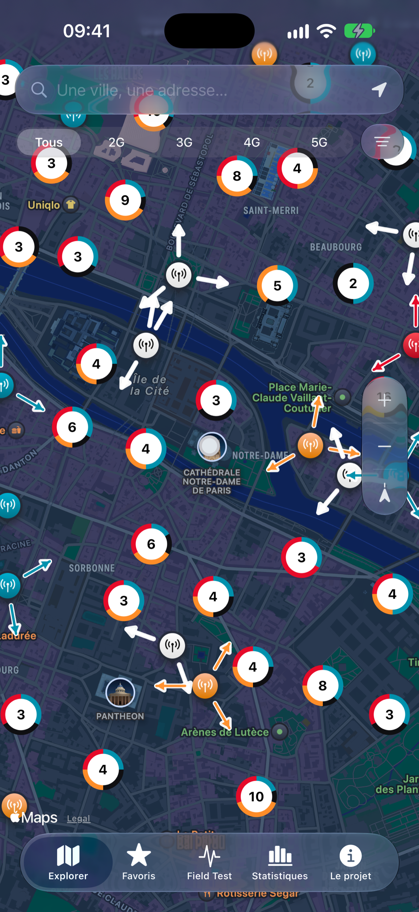

  <picture>
    <source media="(prefers-color-scheme: dark)" srcset="docs/images/logo-dark.svg">
    
  </picture>

<h1 align="center">Pylo</h1>

<strong>Les antennes autour de toi</strong> 2G · 3G · 4G · 5G

Je suis étudiant et je voulais comprendre les antennes autour de moi, et ce que veulent vraiment dire les logos 4G et 5G de mon iPhone. J’ai fait Pylo pour ça. L’app est gratuite, sans pub et sans compte.

**[Télécharger sur l’App Store](https://apps.apple.com/app/pylo/id6829750711)** · iPhone et iPad, iOS 18 ou plus récent

  

## Ce qu’il y a dedans

- **La carte** des antennes déclarées à l’ANFR, avec des filtres par opérateur et par génération. Les flèches montrent la direction des antennes.
- **Une fiche par station** : fréquences, hauteur, propriétaire du support, dates, distance et direction depuis toi.
- **Des favoris** à partager ou à ouvrir dans Plans.
- **Un guide Field Test** pour ouvrir le menu caché de l’iPhone (`*3001#12345#*`) et comprendre ce qu’il affiche.
- **Des statistiques** sur toute la France, avec ce qui a changé depuis la dernière publication.
- **Des notifications**, si tu les actives : nouvelles données ANFR, nouvelles antennes ou changements autour des lieux que tu choisis (un rayon pour chaque), changements sur tes stations favorites. Elles arrivent même quand l’app est fermée.

Les données restent consultables hors ligne. Pylo les met à jour tout seul en Wi-Fi, au plus une fois par jour, à partir des publications de l’ANFR.

## Bon à savoir

Les flèches montrent où pointent les antennes, pas jusqu’où elles portent. Et la station la plus proche n’est pas forcément celle à laquelle tu es connecté : iOS ne laisse pas les apps lire cette information, c’est pour ça qu’il y a le guide Field Test.

## Vie privée

Pas de compte, pas de pub, pas de suivi. Tes favoris, ta position et tes zones d’alerte restent sur ton iPhone : pour les notifications, Pylo télécharge la liste des changements de toute la France et fait le tri lui-même. Les notifications instantanées passent par Firebase Cloud Messaging (Google), qui ne reçoit qu’un identifiant technique de notification.

## Contact

Une idée ou un bug ? [Ouvre une issue](https://github.com/Logarex/Pylo/issues) ou écris-moi à [pylo@nephoos.com](mailto:pylo@nephoos.com).

Les notes de version sont dans les [releases](https://github.com/Logarex/Pylo/releases?q=v&expanded=true). Pour contribuer, voir [la doc technique](docs/MAINTENANCE.md).

## Sources et licence

- [ANFR : réseaux mobiles](https://www.data.gouv.fr/datasets/donnees-sur-les-reseaux-mobiles)
- [ANFR : installations radioélectriques de plus de 5 watts](https://www.data.gouv.fr/datasets/donnees-sur-les-installations-radioelectriques-de-plus-de-5-watts-1)
- [API géographique de l’État](https://geo.api.gouv.fr/) pour les noms des communes
- [RNC Mobile](https://www.rncmobile.net/), un projet communautaire pour relier les identifiants radio aux antennes

Code sous [licence GPL-3.0](LICENSE). Données ANFR sous Licence Ouverte 2.0. Les autres attributions sont dans [NOTICE.md](NOTICE.md). Pylo est un projet indépendant, sans lien avec Apple, l’ANFR ou les opérateurs.
